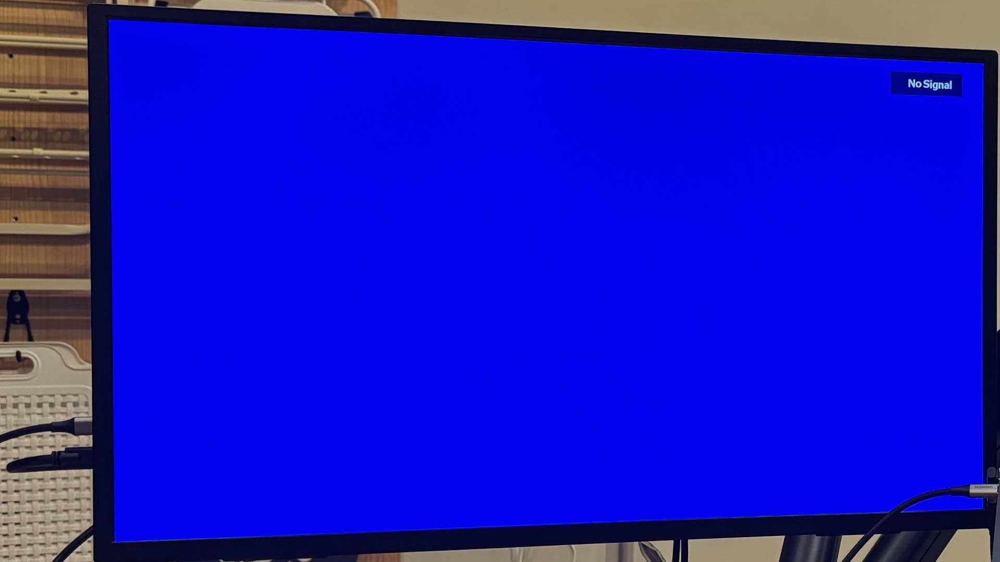
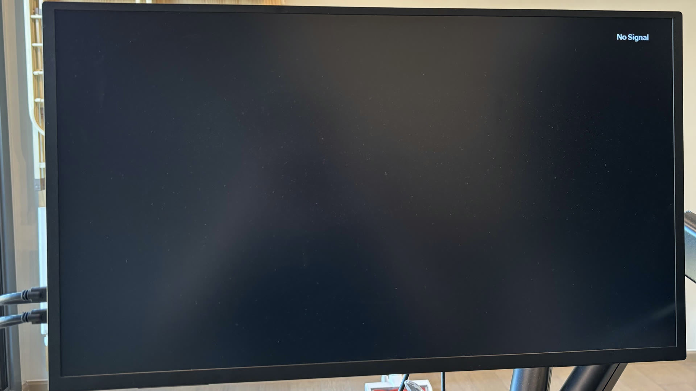

# UPERFECT M245T01: black "No Signal" screen instead of bright blue

The UPERFECT M245T01 portable monitor (24.5", 2560×1440, 165 Hz, Realtek scaler) shows a **bright blue
full-screen "No Signal" page** whenever the source goes away, for about a minute, before it sleeps. There is no
OSD option to turn it off, and in a dark room it lights the room up.

This repo documents a **one-byte firmware patch** that makes that page black. It was done entirely from a Mac over
the USB-C cable, without opening the monitor.

| Before | After |
|---|---|
|  |  |

> [!WARNING]
> Flashing firmware can brick your monitor and voids the warranty. Everything here was tested on **one** unit, with
> one firmware version. Read the whole README, make a verified backup, and stop if anything differs from what is
> described. You do this at your own risk.

## The patch

| | |
|---|---|
| Flash chip | Puya P25Q80 (JEDEC `85 60 14`), 1 MiB |
| File offset | `0x08C600` (code bank 8, address `0xC600`) |
| Change | `FF` → `00` |
| Instruction | `MOV R3,#0xFF` → `MOV R3,#0x00` (the blue component of the background colour) |

The function at bank 8 `0xC5FF` (`7B FF E4 FD FF 12 07 8D D2 03 12 07 93 22`) sets the display background to
`R=0, G=0, B=0xFF` and switches on force-to-background. The firmware calls it when it draws the "No Signal" message,
just before it turns the backlight on. With the patch, the backlight still comes on and the "No Signal" text is still
drawn, but on black.

**Only apply it if your dump has exactly those 14 bytes at `0x08C5FF`.** A different firmware version will have the
code somewhere else.

`FF` → `00` only clears bits. NOR flash can clear bits **without an erase**, so the patch is one single-byte
page-program command and no other byte of the flash is touched.

Firmware facts (no checksum, flash layout, protection bits, how the blue was found) are in
[`docs/firmware-analysis.md`](docs/firmware-analysis.md).

## How it works: Realtek ISP over USB-C (DisplayPort AUX)

Realtek scalers have an in-system-programming (ISP) slave at I²C address `0x4A`. On this monitor it answers over
the DisplayPort AUX channel of a **USB-C (DisplayPort Alt Mode)** connection. Apple Silicon Macs can reach it through
the private `IOAVService` API (the same one `m1ddc` uses for DDC/CI). It was flashed with the monitor's USB-C plugged
into a USB-C dock (WS-UTD41-C), which passes the AUX channel through. The same dock's mini-HDMI output blocked DDC,
so use USB-C, not HDMI.

`tools/rtd-isp.swift` implements:

| Mode | Writes flash | What it does |
|---|---|---|
| `regs` | no | read ISP registers without halting |
| `jedec` | no | identify the flash chip |
| `dump <out.bin>` | no | read the full 1 MiB flash (~92 s) |
| `status` | no | flash status/config registers and protection bits |
| `readback <addr> <len>` | no | hex dump plus diff against your backup |
| `sector-dry <image> <addr>` | no | compare a 4 KiB sector of live flash, backup and patched image |
| `scaler r:XX w:XX=YY bg bgset:R,G,B` | no (volatile scaler registers) | poke scaler registers, used to prove where the blue comes from |
| `byte-program <addr> <value> --i-have-a-backup` | **1 byte** | 1→0-only program, then read back the sector and both neighbours |

Entering ISP **halts the scaler's MCU**. On this chip the ISP reset command does not reboot it, so after every ISP
command **unplug the monitor's power and USB-C, then plug them back in**. The picture keeps running while it is
halted. No ISP command writes flash except `byte-program`.

The protocol comes from [awto-au/awto-ddc](https://github.com/awto-au/awto-ddc) (`rtd_isp_probe.py`,
`rtd_flash_sector.py`), which builds on [naorunaoru/rtdflash](https://github.com/naorunaoru/rtdflash) and
[ghent360/RTD-2660-Programmer](https://github.com/ghent360/RTD-2660-Programmer). See
[`docs/flash-writer-protocol.md`](docs/flash-writer-protocol.md).

## Recreate it

Needs an Apple Silicon Mac and the monitor on **USB-C** (Source = Type-C or Auto), directly or through a USB-C dock,
not HDMI. No other external display may be connected. Check the link with `brew install m1ddc` and
`m1ddc get luminance`: if it answers, DDC gets through and so does ISP.

```sh
cd tools
swiftc -O rtd-isp.swift -o ~/.local/bin/rtd-isp
mkdir -p firmware

# 1. Backup, TWICE, and compare. Power-cycle the monitor (power + USB-C) after each dump.
rtd-isp dump firmware/dump-a.bin      # then power-cycle
rtd-isp dump firmware/dump-b.bin      # then power-cycle
cmp firmware/dump-a.bin firmware/dump-b.bin && shasum -a 256 firmware/dump-a.bin
# Keep these files safe, in more than one place. They are your only way back.

# 2. Check that your firmware matches: the 14 bytes at 0x08C5FF.
xxd -s 0x8C5FF -l 14 firmware/dump-a.bin   # expect: 7bff e4fd ff12 078d d203 1207 9322

export RTD_BACKUP=firmware/dump-a.bin RTD_BACKUP_SHA256=<sha from step 1>

# 3. Read-only checks (each one halts the MCU: power-cycle afterwards).
rtd-isp status                      # expect JEDEC 85 60 14, SR1=0xFC SR2=0x40, WPS=0 (see below)
cp firmware/dump-a.bin firmware/patched.bin
printf '\x00' | dd of=firmware/patched.bin bs=1 seek=$((0x8C600)) conv=notrunc
rtd-isp sector-dry firmware/patched.bin 0x08C000   # must say DRY RUN OK, 1 byte differs

# 4. Rehearsal on blank, unused flash (bank 15 is all FF on this firmware; check yours first).
xxd -s 0xF0000 -l 16 firmware/dump-a.bin            # must be all ff
rtd-isp byte-program 0x0F0000 0x00 --i-have-a-backup   # must print OK, only that byte changed

# 5. The real patch (can run in the same halted session as step 4).
rtd-isp byte-program 0x08C600 0x00 --i-have-a-backup   # must print OK, only that byte changed

# 6. Power-cycle. Unplug the video: "No Signal" should now be black.
```

Keep the Mac on its charger and awake (`caffeinate -dims`), and don't touch the cables while `byte-program` runs.

### Flash protection

The status registers read `SR1=0xFC` (BP4..BP0 = `11111`) and `SR2=0x40` (CMP = 1). That looks like "all protected",
but CMP = 1 inverts the table. In the Puya P25Q80H/SH datasheet, CMP=1 with BP=`xx11x` protects **nothing**. The
firmware itself restores exactly `0xFC` after its own settings writes. `byte-program` accepts only this combination
with WPS = 0 (config register `0x15` bit 2), and **never writes the status register**.

### Undo / recovery

You can't go back from `00` to `FF` without erasing the 4 KiB sector, and this tool doesn't erase. To restore the
original firmware, write your backup with a CH341A programmer and a SOIC-8 clip on the flash chip (inside the case),
or extend the tool with a sector erase + program (see `rtd_flash_sector.py` in awto-ddc).

## Also in this repo

- **`ghidra/`**: headless Ghidra scripts that split the dump into Keil C51 code banks, stub the bank-switch
  trampolines and seed jump tables (`run.sh`, `Setup.java`, `Dump.java`). Paths inside are relative to this folder.
- **`tools/catch_blue.py`**: the experiment that watched the monitor through a camera and halted the MCU when the
  screen turned blue. It's specific to my camera setup and only kept for reference. It showed that the blue only
  appears after the DisplayPort link is gone, so the code had to be found statically.
- **`docs/realtek-sdk-notes.md`**: notes on the Realtek SDK's no-signal, background-colour and backlight code.

## Firmware images

No firmware images are published (copyright, and the settings banks are unit-specific). Dump your own.

## Credits

- [awto-au/awto-ddc](https://github.com/awto-au/awto-ddc): the Realtek RTD ISP-over-DDC/DP-AUX tooling and notes this is
  based on.
- [naorunaoru/rtdflash](https://github.com/naorunaoru/rtdflash), [ghent360/RTD-2660-Programmer](https://github.com/ghent360/RTD-2660-Programmer):
  the original ISP protocol work.
- [m1ddc](https://github.com/waydabber/m1ddc): DDC/CI on Apple Silicon. `IOAVService` usage is modelled on it.
- Realtek SDK copies on GitHub (e.g. `Kingdomwhisky/RTD-Scaler-TEST`), used as a map of the firmware.

Reverse engineering and tooling were done together with Claude Code.

## License

MIT for the code and docs in this repo. See [LICENSE](LICENSE). No affiliation with UPERFECT or Realtek.
